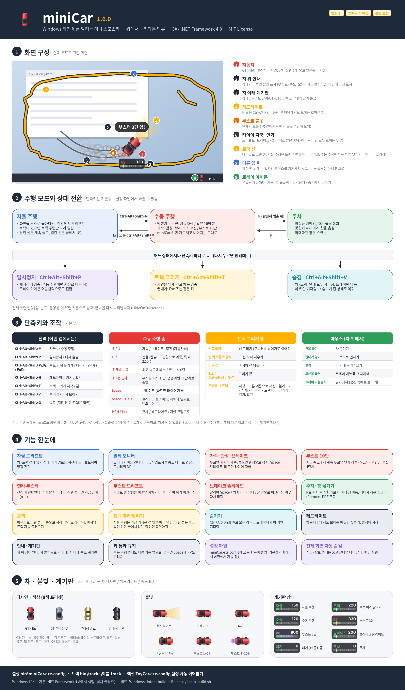

# miniCar



> 인포그래픽 원본(편집 가능): [`docs/miniCar_infographic.excalidraw`](docs/miniCar_infographic.excalidraw) — [excalidraw.com](https://excalidraw.com)이나 VS Code Excalidraw 확장에서 열 수 있습니다.

Windows 화면 위를 돌아다니는 조그만 스포츠카입니다. 위에서 내려다본 모습입니다.
디자인은 오리지널 **GT**(긴 보닛, 뒤로 물린 캐빈, 검은 루프, 슬림 LED)와 **클래식**(레이싱 스트라이프) 중에서 고르고, 색상은 8가지 프리셋 중에서 고를 수 있습니다.
항상 다른 창 위에 떠 있지만 작업 중인 앱의 포커스는 가져가지 않습니다. 투명한 주변 영역의 클릭은 아래 창으로 그대로 통과합니다.

- **자율 주행**: 화면 끝에 닿기 전에 **드리프트**하며 반사 방향으로 돌아 나가고, 타이어 자국과 연기를 남깁니다. 모니터가 여러 대면 옆 모니터로 건너갑니다.
- **수동 주행**: 방향키로 운전합니다. 조작 방식은 두 가지입니다.
  - **자동차식** (기본): ↑ 가속, ↓ 브레이크/후진, ←→ 핸들
  - **탑뷰 게임식**: 방향키가 곧 화면 방향이고, 16방향으로 움직일 수 있습니다
- 누르고 있으면 점점 가속하고, 놓으면 관성으로 서서히 멈춥니다. Space는 브레이크입니다.
- 최고 속도에서 계속 가속하면 **부스트 1단 → 2단 → 3단**으로 더 빨라지고, 배기구에서 불꽃이 나옵니다.
- **주차와 창 옮기기**: 멈춘 상태에서 `P`로 주차한 뒤 방향키를 누르면, 차 아래에 있는 창을 상하좌우로 옮깁니다. 최대화된 창이면 그 창을 스크롤합니다.
- **마우스**: 차를 끌어서 옮기거나, 끌다가 놓으면서 던질 수 있습니다.

---

## 1. 실행

1. `bin\miniCar.exe`를 더블클릭합니다. (git 저장소에는 `bin/`이 들어 있지 않으므로, 소스만 받았다면 먼저 [6. 빌드](#6-빌드)를 하세요.)
2. 주 모니터 가운데에서 차가 출발하고, 작업표시줄 트레이(시계 옆)에 빨간 차 아이콘이 생깁니다.
3. 종료는 `Ctrl+Alt+Shift+Q`, 또는 트레이 아이콘 우클릭 → **종료**입니다.

- Windows 10/11에 기본 내장된 **.NET Framework 4.8**에서 돌아가므로 따로 설치할 것이 없습니다.
- `miniCar.exe.config`(모든 설정 + 모니터별 DPI 설정)는 exe와 **같은 폴더**에 두세요. 없으면 첫 실행 때 기본값으로 다시 만듭니다.
- 한 번에 하나만 실행됩니다. 두 번째로 실행하면 "이미 실행 중"이라고 알려 줍니다.
- 서명 없는 exe라서 처음 실행할 때 SmartScreen 경고가 뜰 수 있습니다. **추가 정보 → 실행**을 누르면 됩니다.
- 새 버전으로 바꿀 때는 실행 중인 miniCar를 먼저 종료하세요.
- 예전 이름(ToyCar)으로 쓰던 `ToyCar.exe.config`가 같은 폴더에 있으면, 첫 실행 때 그 설정을 이어받아 `miniCar.exe.config`를 만듭니다 (옛 파일은 그대로 둠).

## 2. 조작법

### 단축키 (어떤 앱을 쓰고 있어도 동작)

| 동작 | 기본 단축키 |
|---|---|
| 멈추기 / 다시 움직이기 | `Ctrl+Alt+Shift+P` |
| 자율 주행 ↔ 수동 주행 | `Ctrl+Alt+Shift+M` |
| 빠르게 / 느리게 (7단계) | `Ctrl+Alt+Shift+PageUp` / `Ctrl+Alt+Shift+PageDown` |
| 종료 | `Ctrl+Alt+Shift+Q` |
| **숨기기 / 다시 보이기** | `Ctrl+Alt+Shift+V` |
| **트랙 그리기 시작 / 끝내기** | `Ctrl+Alt+Shift+T` |

상태가 바뀌면 차 위에 잠깐 표시가 뜹니다 (예: `속도 4/7`, `일시정지`).

### 자율 주행과 드리프트

자율 주행 중에는 앞쪽에 벽(이웃 모니터가 없는 화면 끝)이 있는지 미리 살핍니다. 부딪히기 전에 이렇게 방향을 바꿉니다.

1. 벽에 닿을 지점까지의 거리와 벽에 들어가는 각도로, 돌기 시작할 시점을 계산합니다. 정면으로 들어갈수록 일찍, 비스듬할수록 늦게 시작합니다.
2. 진입하면서 **브레이크등**이 켜지고 속도가 약 20% 줄어듭니다.
3. 진행 방향이 반사 방향까지 돌고, 차체는 그보다 더 돌아가 **뒤가 바깥으로 미끄러집니다**(슬립각, 최대 35°). 빠져나가면서 슬립이 줄어 차체가 진행 방향과 다시 맞습니다.
4. 뒷바퀴 자리에 **타이어 자국**과 **연기**가 남습니다. 연기는 곧 흩어지고, 자국은 2.5초에 걸쳐 사라집니다.
   - 바탕이 검든 희든 보이도록 밝은 색과 어두운 색을 겹쳐 그립니다. 타이어 자국은 어두운 심에 밝은 테두리를, 연기는 밝은 가운데에 어두운 가장자리를 둡니다.

- **모서리 근처**에서는 돌기 전에 경로를 미리 따라가 봅니다. 옆 벽에 막히면 더 급하게 돌기, 반대쪽으로 돌기, U턴 순으로 다른 경로를 고릅니다.
- 그래도 피할 수 없는 경우(시뮬레이션에서 일반 화면 기준 약 1~2%)에는 예전처럼 벽에서 바로 튕깁니다.
- 끄거나 세기를 바꾸려면 설정의 `AutoDrift`, `DriftTurnDegreesPerSecond`, `DriftSlipDegrees`, `SkidMarks`, `SkidMarkFadeSeconds`를 고치세요.

### 수동 주행

`Ctrl+Alt+Shift+M`을 누르면 수동 주행으로 바뀝니다. **차를 마우스로 클릭하면** 차 위에 키 안내 팝업이 켜지고, 한 번 더 클릭하면 꺼집니다. 기본은 꺼져 있으며, 켜고 끈 상태는 설정(`ShowKeyGuide`)에 저장됩니다.
조작 방식은 트레이 메뉴 **수동 조작 방식**에서 바로 바꿀 수 있습니다. 설정 파일의 `ManualControlStyle`로도 바꿀 수 있습니다.

#### 자동차식 (기본)

| 키 | 동작 |
|---|---|
| `↑` | 앞으로 가속. 누르고 있을수록 빨라짐 (약 1.5초 만에 최고 속도) |
| `↓` | 앞으로 가는 중이면 **브레이크**. 멈춘 뒤에도 누르고 있으면 **후진** (최고 속도의 35%) |
| `←` `→` | **핸들**. 움직이는 동안만 돌고, 느릴수록 덜 돎. 후진할 때는 실제 차처럼 반대로 돎 |
| (키를 놓음) | **관성**으로 미끄러지다 서서히 멈춤 (최고 속도에서 약 2.5초) |
| `Space` | **브레이크**. 약 0.35초 만에 멈춤. 빠를 때 밟으면 멈출 때까지 **타이어 자국**이 남음 |

- 브레이크를 밟으면 빨간 브레이크등이, 후진할 때는 흰 후진등이 켜집니다.
- 벽에 비스듬히 닿으면 벽을 따라 미끄러지며 느려집니다. 정면으로 부딪혀 멈췄을 때는 `↓`로 후진하거나, `↑`(또는 `↓`)를 누른 채 `←` `→`로 핸들을 돌려 빠져나올 수 있습니다. 벽에 붙어 있는 동안에는 핸들이 천천히 돕니다.

#### 탑뷰 게임식 (16방향)

방향키가 곧 화면 방향입니다 (↑ = 화면 위쪽). 22.5° 간격으로 16방향을 고를 수 있습니다.

| 누르는 방법 | 방향 |
|---|---|
| 방향키 하나 | 그 방향 (↑ → ↓ ←, 4방향) |
| 두 키를 함께 누름 | 대각선 45° (↗ ↘ ↙ ↖, 4방향) |
| 한 방향을 누른 채 옆 방향키를 **톡** (0.2초 미만) | 그쪽으로 **22.5°** 꺾고 유지 (그 사이 8방향) |
| 한 번 더 톡 | 45°까지 더 꺾임 |
| 반대쪽 옆 키를 톡 | 22.5°씩 되돌아옴 |
| 한 방향을 누른 채 옆 방향키를 **계속** 누름 | 대각선. 떼면 누르기 전 방향으로 복귀 |

예를 들어 `↑`를 누른 채 `→`를 톡 치면 북북동(22.5°)으로 계속 달립니다.

- 누르고 있으면 그 방향으로 점점 가속하고, 놓으면 관성으로 멈춥니다. `Space`는 브레이크입니다.
- 달리는 중에 방향을 바꾸면 살짝 미끄러지면서 꺾이고, 차 앞부분은 실제로 움직이는 방향을 향합니다.

#### 부스트 (두 방식 공통, 최대 10단계)

가속 키(자동차식은 `↑`, 탑뷰는 진행 방향 키)를 계속 누르고 있으면, 최고 속도에 닿은 뒤 **1초마다** 한 단계씩 올라갑니다.

| 단계 | 최고 속도 (기본 최고 속도 ×) | 배기 불꽃 |
|---|---|---|
| 기본 | × 1.0 | 없음 |
| 부스트 1~2단 | × 1.4 / 1.8 | 짧은 주황 |
| 부스트 3~4단 | × 2.3 / 2.8 | 조금 긴 빨강 |
| 부스트 5~7단 | × 3.4 / 4.0 / 4.7 | 긴 파랑 |
| 부스트 8~10단 | × 5.4 / 6.2 / 7.0 | 가장 긴 보라 |

- 단계가 오를 때마다 차 위에 `부스트 N단`이 표시됩니다. 높은 단계일수록 속도가 천천히 붙습니다.
- 계속 누르기만 하면 10단까지 약 23초 걸립니다(시뮬레이션 기준). 화면 안에서는 자동차식으로 원을 그리며 달리거나, 아래의 연타 출발을 쓰면 됩니다.
- 가속 키를 놓으면 불꽃이 꺼지고 관성으로 달립니다. 속도가 아래 단계 최고 속도의 90% 밑으로 떨어지면 단계도 내려갑니다.
- 예: 기본 속도 단계 3(150px/s)에서 10단은 1,050px/s, 속도 단계 7(560px/s)에서는 3,920px/s입니다.
- 배율과 단계가 오르는 시간은 설정에서 바꿀 수 있습니다(`ManualBoostMultipliers`, `ManualBoostHoldSeconds`). 배율을 적은 만큼이 최대 단계 수(최대 10)이고, 빈 값(`value=""`)이면 부스트가 꺼집니다.

#### 연타 부스터 (출발 / 주행 중 단계 올리기)

전진 키를 **연달아 누르면** 두 번째부터 누를 때마다 부스터가 한 단계씩 올라갑니다. 멈춘 상태에서도, 달리는 중에도 됩니다.

멈춘 상태에서:

| 누르는 횟수 | 출발 단계 |
|---|---|
| 1번 | 일반 출발 |
| 2번 | 부스터 1단 |
| 3번 | 부스터 2단 |
| n번 | 부스터 n−1단 (최대 10단) |

달리는 중에는 **지금 단계에 더합니다** (n번 연타 → 지금 단계 + n−1, 최대 10단).

| 지금 단계 | 연타 | 결과 |
|---|---|---|
| 일반 (0단) | 2번 | 1단 |
| 2단 | 3번 | **4단** |
| 9단 | 4번 | 10단 (최대) |

- 전진 키는 자동차식이면 `↑`, 탑뷰면 같은 방향키입니다. 누름 사이 간격이 0.35초 안이어야 연타로 셉니다.
- **마지막 누름은 계속 누르고 있으세요.** 그 단계의 최고 속도까지 약 1.5초 만에 강하게 가속합니다. 이후에는 평소처럼 계속 누르면 단계가 더 올라갑니다.
- 차 위에 멈춘 상태에서는 `부스터 N단 출발!`, 달리는 중에는 `부스터 N단 업!`이 표시됩니다.
- 달리는 중에는 가속 키를 떼었다가 0.35초 안에 다시 누르는 것도 연타로 셉니다. 단계가 원치 않게 오르면 간격을 조금 길게 두세요.
- 연타로 치지 않는 경우: 자동차식에서 후진 중 `↑`, 탑뷰에서 지금 진행 방향(±30°)이 아닌 방향키 (옆 방향 톡 조향과 구분).
- 끄려면 `LaunchTapBoost`를 `false`로, 연타 간격은 `LaunchTapSeconds`로 바꿉니다.

#### 부스트 드리프트

부스트 1단 이상에서 방향을 바꾸면 드리프트합니다. 자율 주행 드리프트처럼 뒤가 미끄러지고 타이어 자국과 연기가 남습니다.

| 조작 방식 | 동작 |
|---|---|
| 자동차식 | `↑`를 누른 채 `←` `→`로 핸들을 꺾으면, 차체가 꺾는 쪽으로 진행 방향보다 더 돌아갑니다(최대 35°). 진행 방향은 평소의 85%만 돌고, 미끄러지는 동안 속도가 조금 줄어듭니다. 핸들을 풀면 약 0.3초 만에 차체가 다시 정렬됩니다. 반대로 꺾으면 슬립도 반대로 넘어갑니다. |
| 탑뷰 | 다른 방향키를 누르면 차체가 먼저 새 방향을 향하고(최대 35°), 접지력이 낮아져 실제 진행 방향은 미끄러지며 천천히 따라갑니다. 새 방향으로 정렬되면 드리프트가 끝납니다. |

- 한번 미끄러지기 시작하면 부스트 단계가 떨어져도 드리프트가 끝날 때까지 이어집니다. 단, 속도가 기본 최고 속도의 60% 아래로 떨어지면 정렬됩니다.
- `Space` 브레이크만 밟으면 드리프트가 풀립니다 (방향키와 같이 밟으면 아래의 브레이크 슬라이드).
- 끄려면 설정 `BoostDrift`를 `false`로, 미끄러지는 정도는 `DriftSlipDegrees`로 바꿉니다(자율 주행 드리프트와 같이 씀).

#### 브레이크 슬라이드

달리면서 **브레이크와 방향키를 같이 누르면** 차체가 그쪽으로 돌아가며 옆으로 미끄러집니다. 부스트가 없어도 됩니다.

| 조작 방식 | 키 |
|---|---|
| 자동차식 | 전진 중 `Space` + `←` / `→` |
| 탑뷰 | `Space` + 지금 진행 방향과 다른 방향키 (예: → 로 달리다 `Space` + `↓`) |

- 차체는 빠르게(초당 약 260°) 돌아가 진행 방향에서 최대 75°까지 옆으로 섭니다. 몸은 관성으로 원래 방향으로 계속 미끄러지고, 진행 방향은 차체 쪽으로 천천히 따라 돕니다.
- 그냥 브레이크보다 조금 길게 미끄러지며(감속 55%), 미끄러지는 동안 타이어 자국과 연기가 남고 계기판에 `슬라이드`가 표시됩니다.
- **그대로 멈추면** 돌아간 방향으로 섭니다. 예) 자동차식으로 오른쪽으로 달리다 `Space`+`→`를 누르고 있으면 약 90° 돌아 아래를 향해 멈춤.
- **중간에 `Space`를 떼면** 바퀴가 다시 잡히며 진행 방향이 차체 쪽으로 정렬되고(속도를 조금 잃음), `↑`(탑뷰는 방향키)로 그 방향으로 이어서 달립니다.
- 느릴 때(기본 최고 속도의 25% 미만)에는 일어나지 않습니다.
- 끄려면 `BrakeSlide`를 `false`로, 돌아가는 최대 각도는 `BrakeSlideDegrees`(10~90)로 바꿉니다.

#### 공통

| 키 | 동작 |
|---|---|
| `PageUp` / `PageDown` (`Ctrl+Alt+Shift`와 함께) | 최고 속도 단계 변경 |
| `P` | 주차 / 주차 해제 (아래 "주차와 창 옮기기") |
| `H` | 헤드라이트 켜기 / 끄기 (아래 "헤드라이트") |
| `Esc` | 자율 주행으로 돌아가기 |

- 자율 주행에서 수동 주행으로 바꾸면, 달리던 속도 그대로 이어집니다.

#### 수동 주행 중 키보드

수동 주행 중에는 **miniCar가 쓰는 키만** 가져가고, 나머지 키는 평소처럼 앱과 Windows로 갑니다.

| 구분 | 키 |
|---|---|
| miniCar가 가져감 | 방향키, `Space`, 주차 키(`P`), 헤드라이트 키(`H`), 수동 주행 종료 키(`Esc`). **수식키(Ctrl/Alt/Shift/Win) 없이 눌렀을 때만**<br>miniCar 단축키 (예: `Ctrl+Alt+Shift+M`, `Ctrl+Alt+Shift+PageUp`) |
| 평소처럼 동작 | 그 밖의 모든 키. 예: `Win+Tab`, `Alt+Tab`, `Win` 단독(시작 메뉴), `Ctrl+C`/`Ctrl+V`, 문자 입력, `Enter`, `F1`~`F12`<br>수식키와 함께 누른 방향키·Space·P·Esc. 예: `Win+←`(창 붙이기), `Shift+→`(선택), `Ctrl+Shift+Esc`(작업 관리자), `Alt+Space`(창 메뉴), `Shift+P`(대문자 P) |

- 방향키로 운전하는 도중에 `Win+Tab`이나 `Alt+Tab`을 눌러도 운전은 계속됩니다.
- 다만 방향키, `Space`, `P`, `H`, `Esc` 단독 입력은 miniCar가 쓰므로, 차를 몰고 있는 동안에는 다른 앱에서 이 키를 쓸 수 없습니다.
- **차가 멈춰 있으면 일반 키를 돌려줍니다.** 수동 주행 모드를 켜 둔 채 다른 앱에서 글을 써도 됩니다.

  | 차 상태 | `Space` | `H`, `P` (단독 글자 키) | 방향키, `Esc` |
  |---|---|---|---|
  | 달리는 중 (또는 방향키를 누르는 중) | 브레이크로 가져감 | 가져감 | 가져감 |
  | 멈춤 (주차 중 포함) | **앱으로 보냄** | 가져감 | 가져감 |
  | 멈춘 뒤 3초 지남 (`ManualIdleSeconds`) — 계기판에 `대기` | **앱으로 보냄** | **앱으로 보냄** (주차 중에는 주차 해제용 `P`만 계속 받음) | 가져감 (방향키로 다시 출발, `Esc`로 수동 주행 종료) |

  - 브레이크로 멈추는 중에 누르고 있던 `Space`는 뗄 때까지 miniCar가 가져갑니다 (앱에 반쪽 입력이 가지 않도록).
  - 방향키는 차를 다시 출발시키는 키라서 멈춰 있어도 가져갑니다. 다른 앱에서 방향키까지 쓰려면 `Esc`로 수동 주행을 끄세요.
- 일시정지하거나 전체 화면 앱이 감지되면 자동으로 자율 주행으로 돌아가서 키보드를 완전히 풀어 줍니다.

### 주차와 창 옮기기

1. 수동 주행 중 차를 옮기고 싶은 창 위로 가져가서 **완전히 멈춥니다** (`Space`).
2. `P`를 누르면 **주차**됩니다. 비상등이 깜빡이고, 차 위에 "주차 · 옮길 창: (창 제목)"이 뜹니다.
3. 방향키를 누르면 차 대신 **그 창이** 상하좌우·대각선으로 움직입니다. 누르고 있을수록 빨라지고(0.5초에 최고 속도), 차도 창에 실린 채 함께 움직입니다.
   - **창이 최대화되어 있으면** 옮기는 대신 그 창을 **스크롤**합니다. `↑` `↓`는 위아래, `←` `→`는 좌우입니다. 한 번 누르면 휠 한 칸이고, 누르고 있으면 점점 빨라집니다(초당 최대 14칸).
   - 스크롤은 **차가 있는 위치에서 실제로 마우스 휠을 굴리는 것**과 같습니다. 그래서 문서나 웹페이지 안의 스크롤 영역이 여러 개면, 차 아래에 있는 영역이 스크롤됩니다.
   - 이를 위해 휠을 굴리는 순간 마우스 커서를 차 위치로 옮겼다가 곧바로 원래 자리로 돌려놓습니다. 이동과 휠과 복귀를 한 번에 보내므로 커서가 움직이는 게 거의 보이지 않습니다.
   - 주차 중에는 차가 클릭을 통과시킵니다. 차 아래 창이 휠을 받을 수 있게 하기 위해서입니다. 그래서 주차 중에는 차를 마우스로 끌 수 없습니다.
4. 다시 `P`를 누르면 주차가 풀리고 운전으로 돌아갑니다. `Esc`를 누르면 바로 자율 주행으로 돌아갑니다.

- 옮길 창은 주차할 때 차 아래에서 가장 위에 보이는 창입니다. 바탕 화면과 작업표시줄은 제외합니다.
- 주차 중에 그 창이 닫히면, 다음에 방향키를 누를 때 차 아래 창을 다시 찾습니다.
- 창을 화면 밖으로 완전히 밀어낼 수는 없습니다. 창 제목 표시줄 가운데가 항상 어느 모니터 안에 남습니다.
- 아직 움직이는 중에 `P`를 누르면 "완전히 멈춘 뒤에 주차할 수 있습니다"라고 알려 줍니다.
- 옮길 수 없는 창은 차 위에 이유를 알려 줍니다.

| 표시 | 이유 |
|---|---|
| 이 창은 옮길 수 없습니다 | 관리자 권한으로 실행된 창이거나, 창이 위치 변경을 거부함 |
| 응답하지 않는 창입니다 | 프로그램이 멈춰 있음 |
| 차 아래에 옮길 창이 없습니다 | 차가 바탕 화면 위에 있음 |

**스크롤이 안 되는 경우**
- Windows 설정 → Bluetooth 및 장치 → 마우스 → **비활성 창 위로 마우스를 가져갈 때 스크롤**이 꺼져 있으면, 휠이 차 아래 창이 아니라 현재 포커스가 있는 창으로 갑니다. 이 설정을 켜거나, 스크롤할 창을 한 번 클릭해 둔 뒤 주차하세요.
- 관리자 권한으로 실행된 창은 Windows 보안 정책 때문에 스크롤할 수 없습니다.
- 설정 `ScrollMethod`를 `"Message"`로 바꾸면, 커서를 움직이지 않고 창에 휠 메시지를 직접 보냅니다. 다만 이 방식은 무시하는 앱이 많습니다. 관리자 권한으로 실행된 창은 스크롤할 수 없습니다.

### 마우스

| 동작 | 결과 |
|---|---|
| 차 위에 마우스 올리기 | 손 모양 커서로 바뀜 |
| 차를 **클릭** (거의 움직이지 않고 0.5초 안에 떼기) | 수동 주행 키 안내 팝업 켜기 / 끄기. 차는 멈추지 않고 계속 달림 |
| 왼쪽 버튼을 누른 채 4px 이상 움직여 **끌기** | 차가 마우스를 따라 움직임. 일시정지 중에도, 다른 모니터로도 가능 |
| 차를 **오른쪽 클릭** | 트레이 아이콘 메뉴를 그 자리에 띄움 (트레이 아이콘을 오른쪽 클릭한 것과 같음) |
| 끌다가 휙 **놓기** (던지기) | 자율 주행: 던진 방향으로 출발 / 수동 주행: 던진 속도로 미끄러지다 관성으로 멈춤 |
| 천천히 놓기 | 원래 방향 그대로 계속 진행 |

- 클릭은 차 몸체에서만 받습니다. 차 주변의 투명한 부분은 클릭이 아래 창으로 통과합니다.
- 차를 클릭해도 작업 중인 창의 포커스는 바뀌지 않습니다.
- 주차 중에는 차가 클릭을 통과시키므로(창 스크롤을 위해) 클릭과 끌기가 되지 않습니다.

### 차 아래 속도 표시

차 바로 아래에 작은 계기판(화면 배율 100%에서 64×25px)이 항상 붙어 다닙니다. 아래 공간이 없으면 차 위로 옮겨 갑니다.

```
 B3        345
 [██▌|||||||  ]
```

- **왼쪽 글자**: 지금 상태를 짧게 보여 줍니다.

  | 표시 | 뜻 |
  |---|---|
  | `자율` / `드리프트` | 자율 주행 / 자율 주행 드리프트 중 |
  | `수동` | 수동 주행 (부스트 없음) |
  | `B1` ~ `B10` | 부스트 1~10단 |
  | `후진` / `주차` / `정지` | 후진 / 주차 / 일시정지 |

  색은 부스트 단계 색입니다. 기본은 초록, 1~2단 주황, 3~4단 빨강, 5~7단 파랑, 8~10단 보라입니다.
- **오른쪽 숫자**: 실제 속력(화면 배율 100% 기준 px/초)입니다. 자율 주행 드리프트 중 감속도 그대로 보입니다.
- **막대**: 수동 주행에서는 오른쪽 끝이 "기본 최고 속도 × 최고 부스트 배율"(기본 ×7.0)입니다. 조금 긴 흰 눈금이 기본 최고 속도이고, 짧은 눈금이 각 부스트 단계의 최고 속도입니다. 채워진 부분은 초록에서 현재 단계 색으로 바뀌어, 가속하는 모습과 다음 단계까지 남은 거리가 실시간으로 보입니다. 자율 주행에서는 막대 끝이 설정 속도입니다.
- 클릭이 통과하는 창이라 마우스 조작을 방해하지 않습니다. 끄려면 트레이 메뉴 **속도 표시**를 누르거나 설정 `ShowSpeedHud`를 `false`로 바꿉니다.

### 헤드라이트

- **수동 주행 중** `H`를 누르면 켜지고, 한 번 더 누르면 꺼집니다.
- **어느 모드에서나** `Ctrl+Alt+Shift+H`를 누르거나, 트레이·오른쪽 클릭 메뉴의 **헤드라이트**로 켜고 끕니다.
- 켜면 앞 램프가 밝게 빛나고 차 앞쪽으로 따뜻한 흰빛이 퍼집니다. 켜고 끈 상태는 설정(`Headlights`)에 저장되어 다음 실행에도 유지됩니다.
- 불빛은 흰빛 위에 옅은 호박색과 가장자리 선을 겹쳐 그립니다. 그래서 어두운 바탕은 물론 흰 바탕에서도 보입니다.
- 불빛은 클릭이 통과하는 별도 창에 차보다 아래로 그리므로, 불빛이 닿은 곳도 평소처럼 클릭할 수 있습니다.
- **`H` 단독 키가 자율 주행 중에는 안 되는 이유**: 자율 주행 중에는 키보드를 가져가지 않습니다. `H` 단독을 전역 단축키로 잡으면 모든 앱에서 h를 입력할 수 없게 되므로, 자율 주행 중에는 조합키(`Ctrl+Alt+Shift+H`)를 씁니다. 두 키 모두 설정(`HeadlightKey`, `HeadlightToggle`)에서 바꿀 수 있습니다.

### 트레이 아이콘

- **더블클릭**: 멈추기 / 다시 움직이기 (숨긴 동안에는 다시 보이기)
- **우클릭 메뉴**: **숨기기**, 일시정지, 수동 주행, **수동 조작 방식**(자동차식 / 탑뷰 게임식), **차 디자인**(GT / 클래식, 색상 8종), **헤드라이트**, **키 안내 보기**, **속도 표시**, 빠르게, 느리게, **트랙 그리기**, **트랙**(저장·불러오기·삭제 등), 설정 파일 열기, 설정 다시 불러오기, 모니터 정보 복사, 종료
- 디자인과 색상은 고르는 즉시 바뀌고, 트레이 아이콘도 같이 바뀝니다. 색상 프리셋은 레드, 실버 블루, 딥 블루, 옐로, 그린, 오렌지, 화이트, 블랙입니다.
- 아이콘에 마우스를 올리면 현재 상태가 보입니다 (예: `miniCar · 자율 · 속도 3/7`).

### 숨기기

`Ctrl+Alt+Shift+V`를 누르면 차와 트랙이 모두 사라집니다. 다시 누르면 숨기기 전 상태(수동 주행이었다면 수동 주행)로 돌아옵니다.

- 숨긴 동안 miniCar는 트레이 아이콘으로만 살아 있고 **아무 동작도 하지 않습니다**. 화면 갱신을 멈추고, 숨기기 키를 뺀 모든 단축키와 키보드 캡처를 풀어서 이 키만 기다립니다.
- 트레이 메뉴에서는 **다시 보이기**와 **종료**만 쓸 수 있습니다. 트레이 아이콘을 더블클릭해도 다시 보입니다.

### 트랙

마우스로 화면에 선을 그려 차가 달릴 트랙을 만들 수 있습니다. **선은 벽처럼 작용**합니다.

- 자율 주행: **트랙을 따라 달립니다** (아래 "자율 주행 · 트랙 따라 달리기"). 따라가기를 끄면 화면 전체를 돌아다니다 선에 닿으면 화면 가장자리처럼 튕겨 나갑니다.
- 수동 주행: 정면으로 부딪히면 멈추고, 비스듬히 부딪히면 선을 긁으며 따라 미끄러집니다 (자동차식은 차체가 선 방향으로 돌아감). 후진이나 핸들로 빠져나옵니다.
- 차 위에 선을 긋거나 차를 선 위에 끌어다 놓으면, 그 선은 차가 완전히 벗어날 때까지 통과합니다 (갇히지 않도록). 벗어난 뒤에는 다시 벽입니다.
- 선은 어두운 테두리 + 밝은 색(기본 호박색) 두 겹이라 흰 바탕·검은 바탕 모두에서 보입니다.
- 차를 숨기면 트랙도 함께 사라지고, 다시 보이게 하면 함께 나타납니다.

#### 자율 주행 · 트랙 따라 달리기

트랙을 그리거나 불러온 상태로 자율 주행에 두면, 차가 화면 전체가 아니라 **트랙 주변만** 달립니다.

- 차에서 **가장 가까운 선 하나**를 골라, 선 옆(선 굵기 + 차 크기만큼 띄운 길)을 따라 달립니다.
- **닫힌 선**(시작과 끝이 맞닿은 고리): 차가 있는 쪽을 계속 돕니다. 고리 안에 있으면 안쪽, 밖에 있으면 바깥쪽.
- **열린 선**: 한쪽 옆을 따라가다 **선 끝에서 U턴**해 반대쪽 옆으로 돌아오고, 반대 끝에서 다시 U턴합니다.
- 선에서 멀리 있으면 먼저 그 선까지 달려온 뒤 따라갑니다.
- 다른 선이나 화면 끝에 길이 막히면 그 자리에서 돌아서 반대 방향으로 갑니다.
- 굽은 곳에서는 속도를 줄이고, 빠르게 크게 돌 때(U턴 등)는 뒤가 미끄러지며 타이어 자국이 남습니다.
- 계기판에 `트랙`으로 표시됩니다.
- 선을 새로 그리거나 지우거나 다른 트랙을 불러오면, 차를 끌어 옮기면, 그때 가장 가까운 선을 다시 고릅니다.
- 끄려면 트레이 메뉴 → 트랙 → **자율 주행은 트랙을 따라 달리기** 체크를 풀거나, 설정 `AutoFollowTrack`을 `false`로 합니다.

#### 그리기

1. `Ctrl+Alt+Shift+T` (또는 트레이 메뉴 → **트랙 그리기**)를 누릅니다. 화면이 옅은 파란색으로 덮이고 차가 멈춥니다.
2. 마우스 조작:

   | 조작 | 동작 |
   |---|---|
   | 왼쪽 버튼 누른 채 끌기 | 선 그리기 (모니터를 넘어가도 이어서 그려짐) |
   | 선 위를 오른쪽 클릭 | 그 선 하나 지우기 |
   | `Ctrl+Z` | 마지막 선 되돌리기 |
   | `Esc` 또는 `Ctrl+Alt+Shift+T` | 그리기 끝 |

3. 그리는 동안에는 화면 아래 앱을 클릭할 수 없습니다 (끝내면 다시 됨). 차는 그리는 동안에도 마우스로 끌어 옮길 수 있습니다.
- 선 굵기는 `TrackWidth`(기본 8px), 색은 `TrackColor`로 바꿉니다. 이미 그린 선의 굵기는 그대로입니다.

#### 저장 · 불러오기 · 삭제 (트레이 메뉴 → 트랙)

| 메뉴 | 동작 |
|---|---|
| 현재: … | 지금 트랙 이름, 저장 안 한 변경이 있는지, 선 개수 |
| 마지막 선 지우기 | 마지막에 그린 선 하나 지우기 |
| 트랙 비우기 (저장하지 않고 지움) | 화면의 트랙을 지우고 새 트랙으로 시작. 저장 안 한 변경이 있으면 한 번 확인. 저장된 파일은 그대로 |
| 저장... / 저장 ('이름'에 덮어쓰기) | 이름을 물어 저장. 이미 이름이 있으면 그 이름에 덮어씀 |
| 다른 이름으로 저장... | 새 이름으로 저장. 같은 이름이 있으면 덮어쓸지 확인 |
| 불러오기 ▸ 이름 | 저장된 트랙 불러오기. 지금 트랙을 저장하지 않았으면 먼저 저장할지 물음 (예 / 아니요 = 버림 / 취소) |
| 삭제 ▸ 이름 | 저장된 트랙 파일 삭제 (확인 후, 되돌릴 수 없음). 화면에 보이는 트랙이면 화면에는 남고 "저장 안 한 트랙"이 됨 |
| 자율 주행은 트랙을 따라 달리기 | 켜면 자율 주행이 트랙 주변만 달림 (기본 켜짐) |
| 트랙 폴더 열기 | 트랙 파일이 있는 폴더를 탐색기로 열기 |

- 트랙은 exe 옆 `tracks` 폴더에 `이름.track` 텍스트 파일로 저장됩니다. 이름에는 `\ / : * ? " < > |`를 쓸 수 없습니다.
- 마지막으로 저장하거나 불러온 트랙은 다음 실행 때 자동으로 불러옵니다 (`TrackName`).
- 저장하지 않은 트랙이 있는 채로 종료하면 저장할지 묻습니다. **아니요**를 고르면 저장하지 않고 끝납니다.
- 좌표는 화면 픽셀로 저장되므로, 모니터 배치를 바꾸면 트랙 위치가 어긋날 수 있습니다.

## 3. 멀티 모니터

- 이웃한 모니터가 있는 쪽 화면 끝은 그대로 통과해서 건너갑니다. 이웃이 없는 쪽만 벽입니다.
- 크기, 위치, 배율(DPI)이 서로 다른 모니터 배치를 지원합니다. 보조 모니터가 왼쪽이나 위에 있어 좌표가 음수여도 됩니다.
- **모니터를 위아래로 놓은 경우**: 두 화면 사이에 작업표시줄이 끼면, 차가 다닐 수 있는 영역(작업 영역)끼리 떨어지게 됩니다. 240px 이하의 틈은 "다리"로 연결해서 건너갈 수 있게 했습니다. 이때 차가 작업표시줄 위를 지나갑니다.
- 배율이 다른 모니터로 넘어가면 그 모니터 배율에 맞춰 차 크기와 속도가 바뀝니다.
- 모니터를 연결하거나 뺄 때, 작업표시줄을 옮길 때는 1초 안에 자동으로 반영됩니다.

**그래도 건너가지 못한다면** 트레이 메뉴의 **모니터 정보 복사**를 누른 뒤 내용을 붙여서 알려 주세요. 클립보드에 아래 정보가 들어갑니다.

```
프로세스 DPI 인식: PerMonitorV2 (정상)
[1] 주 모니터  DPI 120 (125%)
    전체 영역: (0, 0) ~ (1920, 1080)  1920×1080
    작업 영역: (0, 0) ~ (1920, 1032)  1920×1032
[2] 보조  DPI 144 (150%)
    ...
다리: (0, -60) ~ (1920, 0)  1920×60
```

"DPI 인식"이 `PerMonitorV2`가 아니라면 `miniCar.exe.config`가 exe 옆에 있는지 확인하세요.

## 4. 설정

모든 설정은 exe 옆의 **`miniCar.exe.config`** 파일 `<appSettings>`에 들어 있습니다. 각 항목 바로 위에 설명 주석이 있고, 처음에는 모두 기본값입니다.

```xml
<!-- 정지 → 기본 최고 속도까지 걸리는 시간 (초, 0.05~30) -->
<add key="ManualAccelSeconds" value="1.5" />
```

- 트레이 메뉴 **설정 파일 열기**를 누르면 메모장으로 열립니다. `value="..."` 부분만 고치고 저장한 뒤 **설정 다시 불러오기**를 누르면 바로 적용됩니다.
- 트레이 메뉴나 단축키로 바꾼 값(속도 단계, 조작 방식, 디자인, 색상)도 이 파일에 자동으로 저장됩니다. 이때 바뀐 항목의 값만 고치므로, 설명 주석과 직접 적은 내용은 그대로 남습니다.
- 숫자의 소수점은 점(`.`), 목록은 쉼표(`,`)로 씁니다. 예: `value="1.4,1.8,2.3"`
- 항목을 지우면 기본값이 쓰이고, 다음에 저장할 때 다시 추가됩니다.
- **새 버전으로 바꿨을 때**는 처음 실행할 때 파일을 최신으로 맞춥니다. 직접 바꾼 값은 건드리지 않습니다.
  - 없는 새 항목은 설명 주석과 함께 제자리(관련 항목 옆)에 기본값으로 추가합니다.
  - 각 항목의 설명 주석은 새 버전 내용으로 바꿉니다.
  - 예전 기본값을 그대로 쓰던 항목은 새 기본값으로 바꿉니다. 예: `ManualBoostMultipliers`가 `1.4,1.8,2.3`(0.7까지의 기본값)이면 10단계로 바뀝니다.
- 잘못된 값(예: 숫자 자리에 글자)은 기본값으로 바꾸고 트레이 알림으로 어떤 항목인지 알려 줍니다.
- 파일을 통째로 지우면 다음 실행 때 기본값과 설명이 담긴 파일을 다시 만듭니다. 기본 파일은 exe 안에도 들어 있습니다. 고치다가 XML 형식이 깨져서 실행이 안 될 때도 이 파일을 지우면 됩니다.
- 이전 버전(0.4.2까지)이 쓰던 `%APPDATA%\miniCar\settings.json`은 더 이상 쓰지 않으므로 지워도 됩니다.

| 항목 | 기본값 | 설명 |
|---|---|---|
| `TogglePause` | `Ctrl+Alt+Shift+P` | 멈추기 / 다시 움직이기 |
| `ToggleMode` | `Ctrl+Alt+Shift+M` | 자율 ↔ 수동 주행 |
| `SpeedUp` / `SpeedDown` | `Ctrl+Alt+Shift+PageUp` / `PageDown` | 속도 단계 변경 |
| `Quit` | `Ctrl+Alt+Shift+Q` | 종료 |
| `HideToggle` | `Ctrl+Alt+Shift+V` | 숨기기 / 다시 보이기 (숨긴 동안에는 이 키만 동작) |
| `TrackEditToggle` | `Ctrl+Alt+Shift+T` | 트랙 그리기 시작 / 끝내기 |
| `ManualExitKey` | `Escape` | 수동 주행 중 자율 주행으로 돌아가는 키 |
| `ParkKey` | `P` | 주차 / 주차 해제 키 (수동 주행 중) |
| `ManualIdleSeconds` | `3` | 수동 주행 중 멈춘 뒤 `H`·`P` 같은 단독 글자 키를 앱으로 돌려주기까지의 시간 (초, 0~60). `Space`는 멈추면 바로 돌려줌. 0이면 글자 키는 항상 가져감 |
| `SpeedLevels` | `60,100,150,220,300,420,560` | 속도 단계 (배율 100% 기준 px/초). 수동 주행에서는 최고 속도 |
| `SpeedIndex` | `2` | 현재 속도 단계 (0부터 셈, 종료할 때 저장됨) |
| `BounceJitterDegrees` | `8` | 튕길 때 무작위로 더하는 각도(±). 0이면 정확한 반사각 |
| `AutoDrift` | `true` | 자율 주행: 벽에 닿기 전에 드리프트하며 방향 전환. `false`면 벽에 닿는 순간 반사 |
| `DriftTurnDegreesPerSecond` | `240` | 드리프트 중 진행 방향이 도는 속도 (°/초, 60~720). 클수록 벽 가까이에서 짧고 급하게 돎 |
| `DriftSlipDegrees` | `35` | 드리프트 중 차체가 진행 방향보다 더 돌아가는 최대 각도 (°, 0~70). 0이면 미끄러짐 없이 돎 |
| `SkidMarks` | `true` | 드리프트할 때 타이어 자국과 연기 표시 |
| `SkidMarkFadeSeconds` | `2.5` | 타이어 자국이 완전히 사라지기까지 걸리는 시간 (초, 0.2~30) |
| `ManualControlStyle` | `Car` | 수동 조작 방식: `Car`(자동차식) / `TopDown`(탑뷰 게임식 16방향) |
| `SteeringDegreesPerSecond` | `200` | 자동차식: 핸들을 끝까지 돌렸을 때 초당 회전 각도 |
| `ManualAccelSeconds` | `1.5` | 수동: 정지 → 최고 속도까지 걸리는 시간 |
| `ManualCoastSeconds` | `2.5` | 수동: 키를 놓았을 때 최고 속도 → 정지까지 걸리는 시간 (클수록 오래 미끄러짐) |
| `ManualBrakeSeconds` | `0.35` | 수동: 브레이크로 최고 속도 → 정지까지 걸리는 시간 |
| `ManualBoostMultipliers` | `1.4,1.8,2.3,2.8,3.4,4,4.7,5.4,6.2,7` | 수동: 부스트 단계별 최고 속도 배율 (최대 10단계, 1.0~20.0). 빈 값(`""`)이면 부스트 끔 |
| `ManualBoostHoldSeconds` | `1.0` | 수동: 현재 단계 최고 속도에서 이만큼(초) 더 가속하면 다음 부스트 단계 |
| `BoostDrift` | `true` | 수동: 부스트 중 방향을 바꾸면 드리프트 (슬립 크기는 `DriftSlipDegrees`, 자국은 `SkidMarks`를 따름) |
| `LaunchTapBoost` | `true` | 수동: 전진 키 연타 → 부스터 (연타 수 − 1)단 상향. 멈춤이면 그 단계로 출발, 주행 중이면 지금 단계에 더함 |
| `LaunchTapSeconds` | `0.35` | 연타로 인정하는 누름 간격 (초, 0.1~1.0) |
| `BrakeSkidMarks` | `true` | 수동: 빠를 때(기본 최고 속도의 20% 이상) 브레이크를 밟으면 멈출 때까지 타이어 자국 |
| `BrakeSlide` | `true` | 수동: 달리며 브레이크 + 방향키 → 차체가 돌아가며 옆으로 미끄러짐 |
| `BrakeSlideDegrees` | `75` | 브레이크 슬라이드 때 차체가 진행 방향에서 최대로 돌아가는 각도 (°, 10~90) |
| `WindowMoveSpeed` | `800` | 주차 중 창을 옮기는 최고 속도 (배율 100% 기준 px/초) |
| `ScrollNotchesPerSecond` | `14` | 주차 중 최대화된 창을 스크롤할 때, 누르고 있으면 초당 최대 휠 칸 수 |
| `ScrollMethod` | `Input` | `Input`: 차 위치에서 실제 휠 입력 (커서를 잠깐 옮김, 대부분의 앱에서 동작) / `Message`: 휠 메시지 직접 전송 (커서 안 움직임, 무시하는 앱 많음) |
| `ParkCarFollowsWindow` | `true` | `true`: 창을 옮길 때 차도 함께 이동 / `false`: 차는 제자리 |
| `CarDesign` | `GT` | 차 디자인: `GT` / `Classic` |
| `CarColor` | `#E53935` | 차체 색 (HTML 색 코드). 트레이 메뉴에서 프리셋으로 고를 수도 있음 |
| `CarLength` | `48` | 차 길이 (배율 100% 기준 px) |
| `TrackWidth` | `8` | 새로 그리는 트랙 선 굵기 (배율 100% 기준 px, 2~40) |
| `AutoFollowTrack` | `true` | 자율 주행에서 트랙이 있으면 트랙을 따라 달림 (닫힌 선은 계속 돌고, 열린 선은 끝에서 U턴). `false`면 화면 전체를 돌아다니고 선에서 튕김 |
| `TrackColor` | `#FFB300` | 트랙 선 가운데 색 (바깥에 어두운 테두리가 함께 그려짐) |
| `TrackName` | (빈 값) | 시작할 때 불러올 트랙 이름. 저장하거나 불러올 때 자동으로 바뀜 |
| `UseWorkArea` | `true` | `true`: 작업표시줄을 벽으로 취급 / `false`: 작업표시줄 위로도 다님 |
| `HideOnFullscreen` | `true` | 전체 화면 앱(게임, 동영상), PPT 슬라이드쇼, 잠금 화면에서 자동으로 숨김 |
| `ShowKeyGuide` | `false` | 수동 주행 중 차 위 키 안내 팝업. 차를 클릭할 때마다 켜고 끄며 여기에 저장됨 |
| `ShowSpeedHud` | `true` | 차 아래 부스트 단계·속도·속도 막대 표시 |
| `Headlights` | `false` | 헤드라이트 켜짐 (켜고 끈 상태가 저장됨) |
| `HeadlightKey` | `H` | 수동 주행 중 헤드라이트 켜기/끄기 키 (수식키 없이) |
| `HeadlightToggle` | `Ctrl+Alt+Shift+H` | 헤드라이트 켜기/끄기 전역 단축키 (모든 모드) |

**단축키 작성법**: `Ctrl`, `Alt`, `Shift`, `Win` 중 원하는 것과 키 하나를 `+`로 잇습니다.
- 키 이름 예: `A`~`Z`, `0`~`9`, `F1`~`F12`, `PageUp`, `PageDown`, `Home`, `End`, `Insert`, `Delete`, `Up`, `Down`, `Left`, `Right`, `Escape`(`Esc`), `Space`, `Plus`, `Minus`
- 예: `value="Ctrl+Alt+F9"`, `value="Win+Shift+C"`
- 다른 프로그램이 이미 쓰는 조합은 등록에 실패하고, 트레이 알림으로 어떤 단축키가 실패했는지 알려 줍니다.
- `ParkKey`와 `ManualExitKey`는 수동 주행 중에만 쓰이는 키라서, 다른 프로그램의 단축키와 겹쳐도 됩니다. 단, 방향키와 `Space`는 피하세요.

## 5. 알아 둘 점

- **보안 솔루션**: 수동 주행은 저수준 키보드 훅(`WH_KEYBOARD_LL`)으로 키를 받습니다. CrowdStrike 같은 EDR이 이를 키로거로 오인해서 막을 수 있습니다. 막히면 차 위에 "키보드 캡처를 시작하지 못했습니다"가 뜨고, 자율 주행과 마우스 기능은 그대로 동작합니다. 훅은 수동 주행 중에만 설치하고 빠져나오면 바로 해제합니다.
- **관리자 권한 창**: 관리자 권한으로 실행된 창은 Windows 보안 정책 때문에 옮길 수 없습니다. 그런 창이 포커스를 갖고 있으면 수동 주행 키 입력이 차로 전달되지 않을 수도 있습니다.
- **창 옮기기**: 일반 앱 창은 대부분 옮겨집니다. 일부 앱(전체 화면 게임, 특수한 오버레이 등)은 위치 변경을 무시할 수 있습니다.
- **다른 최상위 창**: 작업 관리자처럼 항상 위에 있는 다른 창이 차를 가릴 수 있습니다. 1초마다 다시 맨 위로 올라옵니다.
- **CPU 사용량**: 화면 갱신 주기(보통 60Hz)에 맞춰 그리고, 일시정지 중이거나 숨겨져 있으면 그리기를 완전히 멈춥니다. 타이어 자국은 드리프트 구간만 덮는 작은 창에 그리고, 사라지는 동안에는 다시 그리지 않고 투명도만 바꿉니다.

## 6. 빌드

소스를 고친 뒤 다시 빌드하는 방법입니다.

- **Linux** (현재 `bin\miniCar.exe`를 만든 방식):
  ```bash
  sudo apt install dotnet-sdk-8.0 mono-devel
  ./build.sh        # → bin/miniCar.exe, bin/miniCar.exe.config
  ```
  .NET 8 SDK에 들어 있는 최신 C# 컴파일러로, Mono의 .NET Framework 4.8 참조 어셈블리를 대상으로 컴파일합니다.
- **Windows** (.NET SDK 또는 Visual Studio가 있을 때): `dotnet build -c Release` → `bin\Release\net48\miniCar.exe` (설정 파일 `miniCar.exe.config`도 같은 폴더에 생김)
- 빌드 결과(`bin/`, `obj/`)는 `.gitignore`로 저장소에서 뺍니다.

최신 C# 문법(record, 패턴 매칭, nullable)을 쓰고, .NET Framework 4.8에 없는 API는 `Polyfills.cs`에서 보충합니다.

## 7. 소스 구조

| 파일 | 역할 |
|---|---|
| `Program.cs` | 진입점, 중복 실행 방지 |
| `TrayApp.cs` | 전체 조립: 트레이 메뉴, 단축키 연결, 프레임 루프, 모드 전환, 주차, 드래그 처리, 1초 주기 점검(모니터, 최상위, 전체 화면) |
| `CarController.cs` | 주행 시뮬레이션: 자율 주행 반사, 수동 주행(자동차식/탑뷰), 가속·관성·브레이크·후진·부스트, 경계 판정, 던지기 |
| `Direction16.cs` | 탑뷰 게임식 16방향 선택 (톡 치기/길게 누르기 판정) |
| `WindowMover.cs` | 주차 모드: 차 아래 창 찾기, 창 이동, 화면 경계 유지, 최대화된 창 스크롤, 이동 불가 사유 판정 |
| `MonitorLayout.cs` | 모니터 목록과 DPI, 통과 가능 영역(작업 영역 + 다리) 판정, 진단 텍스트 |
| `CarSprite.cs` | 차 그리기(GDI+): GT/클래식 디자인, 색상 프리셋, 그림자, 브레이크등/후진등/비상등/부스트 불꽃. 2° 단위 회전 프레임 캐시 |
| `CarWindow.cs` | 차 창: 몸체만 클릭 가능, 클릭과 끌기 구분(4px·0.5초), 드래그·오른쪽 클릭 이벤트 |
| `LayeredWindow.cs` | 픽셀 알파, 항상 위, 포커스 비활성 창 (공통 기반 클래스) |
| `OsdWindow.cs` | 차 위 상태 표시·키 안내 팝업 (클릭 통과) |
| `HudWindow.cs` | 차 아래 계기판: 상태, 속도, 단계 눈금이 있는 속도 막대 (클릭 통과, 값이 바뀔 때만 다시 그림) |
| `BeamWindow.cs` | 헤드라이트 불빛: 클릭 통과 창, 차보다 아래, 3° 단위 회전 그림 캐시 |
| `CarFollow.cs` | 자율 주행 트랙 따라 달리기: 가장 가까운 선 고르기, 선 옆 길 만들기(열린 선은 끝을 감싸는 U턴 길), 앞쪽 목표점을 향한 핸들·감속 |
| `Track.cs` | 트랙 선 모음, 차와 선의 충돌 깊이 계산(차를 원 3개로 근사), 선 단순화, 파일 형식, `tracks` 폴더 관리 |
| `TrackOverlay.cs` | 모니터마다 트랙 창: 평소에는 선 부분만 클릭 통과로 표시, 그리기 중에는 모니터 전체를 덮어 마우스로 그리기·지우기 |
| `Dialogs.cs` | 맨 위에 뜨는 확인 창, 트랙 이름 입력 창 |
| `SkidEffects.cs` | 드리프트 타이어 자국·연기: 드리프트마다 그 구간만 덮는 클릭 통과 창, 차보다 아래에 표시, 서서히 사라짐 |
| `GlobalHotkeys.cs` | `RegisterHotKey` 전역 단축키 (자율 주행 중) |
| `KeyboardCapture.cs` | 저수준 키보드 훅 (수동 주행 중에만): miniCar가 쓰는 키만 삼키고 나머지는 통과. 프레임 사이 짧은 탭도 놓치지 않음 |
| `Hotkey.cs` | `"Ctrl+Alt+P"` 형식 단축키 해석 |
| `AppSettings.cs` | `miniCar.exe.config` 설정 읽기/쓰기 (주석 유지, 바뀐 값만 저장), 기본값, 범위 보정 |
| `Native.cs` | Win32 API 선언 |
| `Polyfills.cs` | 전역 using, net48 보충 API |
| `App.config` | 설정 파일 원본: 모든 설정의 설명과 기본값, DPI 설정. 빌드하면 `miniCar.exe.config`로 복사되고 exe 안에도 포함됨 |
| `app.manifest` | DPI 인식(PerMonitorV2), 공용 컨트롤 v6 |
| `miniCar.ico` | exe 아이콘 |
| `build.sh` | Linux 빌드 스크립트 |
| `docs/` | 인포그래픽 이미지(`miniCar_infographic.png`)와 Excalidraw 원본 |

### 동작 원리 요약

- **창**: 차와 상태 표시는 `UpdateLayeredWindow`로 그리는 작은 투명 창입니다. 매 프레임 창 위치와 그림을 한 번에 바꿉니다.
- **프레임 루프**: 별도 스레드에서 `DwmFlush()`로 화면 합성 주기를 기다린 뒤 UI 스레드에 한 프레임을 요청합니다. 시간 간격(dt)을 측정해서 계산하므로 주사율이 달라도 속도가 같습니다.
- **반사**: 진행 방향의 차 앞쪽 가장자리 세 점(양 끝과 가운데)이 모두 통과 가능 영역 안이어야 이동합니다. 막히면 그 축의 속도를 뒤집습니다.
- **드리프트**: 진행 방향으로 앞을 4px 간격으로 살펴 처음 막히는 거리 d와 막힌 축을 찾습니다. 회전 반경 R = 속도 ÷ 회전 속도로 돌 때 벽 쪽으로 더 나아가는 거리는 R·(1 − cos β)입니다(β = 벽과 이루는 각). d가 이 거리 + 여유가 되는 순간 드리프트를 시작합니다. 시작하기 전에 계획한 경로를 1/120초 간격으로 미리 따라가 보고, 막히면 다른 후보 경로를 고릅니다. 실제 이동 중에도 매 프레임 벽 검사를 하고, 닿으면 즉시 반사합니다.
- **자동차식 물리**: 속력은 차체 방향의 한 값(후진은 음수)입니다. 핸들은 `회전 속도 × min(1, 속력 / 최고 속도의 30%) × 진행 방향 부호`로 차체를 돌립니다. 그래서 멈춰 있으면 돌지 않고, 후진할 때는 반대로 돕니다.
- **탑뷰 물리**: 속도는 벡터입니다. 고른 방향으로 일정하게 가속하고, 옆으로 미끄러지는 성분은 접지력으로 줄입니다.
- **부스트**: 가속 중 속력이 현재 단계 최고 속도의 98% 이상인 상태가 `ManualBoostHoldSeconds` 동안 이어지면 단계가 오릅니다. 부스트 단계의 가속력은 기본의 60%입니다.
- **연타 부스트**: 가속 키를 새로 누를 때마다 직전 누름과의 간격을 봅니다. 연타의 첫 누름에서 기준 단계를 기억합니다(기본 최고 속도의 35% 미만이면 0, 아니면 지금 단계). 달리는 중에는 진행 방향으로의 누름만 셉니다. 두 번째부터는 누를 때마다 부스트 단계를 (기준 단계 + 연타 수 − 1)로 맞추고 "출발 중" 상태로 둡니다. 출발 중에는 키를 누르고 있는 동안 단계를 유지하고, 가속력을 (그 단계 배율 × 기본 가속력)으로 올려 그 단계 최고 속도에 닿으면 평소 규칙으로 돌아갑니다.
- **브레이크 자국**: 브레이크 중 속력이 기본 최고 속도의 20% 이상이면 드리프트 자국과 같은 창에 직선 자국을 그립니다. 진하기는 속력에 비례하고, 연기는 드리프트의 30%입니다.
- **부스트 드리프트**: 슬립각(차체 − 진행 방향)이 목표값으로 초당 220°씩 커지고 초당 140°씩 돌아옵니다. 슬립각이 3°를 넘는 동안을 드리프트로 봅니다. 자동차식에서는 목표 슬립 = 핸들 방향 × `DriftSlipDegrees` × min(1, 속력 ÷ 기본 최고 속도의 120%)입니다. 탑뷰에서는 목표 슬립 = 고른 방향과 진행 방향의 차이(±`DriftSlipDegrees`로 제한)이고, 접지력을 5에서 1.4로 낮춥니다.
- **최대화된 창 스크롤**
  - 기본(`Input`): `SendInput` 한 번에 [커서를 차 위치로 절대 이동] → [휠 × n] → [커서 원위치]를 보냅니다. 입력은 순서대로 처리되므로 휠은 차 아래 창으로 갑니다. 절대 좌표는 올림으로 정규화해서, 커서가 정확히 원래 픽셀로 돌아옵니다.
  - `Message`: 차 아래의 가장 안쪽 자식 창(`ChildWindowFromPointEx`)에 `WM_MOUSEWHEEL` / `WM_MOUSEHWHEEL`을 `PostMessage`로 보냅니다.
  - 주차 중에는 차 창에 `WS_EX_TRANSPARENT`를 켭니다. Chrome처럼 휠 좌표 아래 창을 다시 확인하는 앱이 miniCar 창을 보고 입력을 버리지 않게 하기 위해서입니다.
- **창 옮기기**: `EnumWindows`로 위에서부터 창을 훑어 차 아래의 첫 번째 일반 창을 고릅니다. 숨김, 최소화, 가상 데스크톱으로 가려진 창, 클릭 통과 오버레이, 바탕 화면, 작업표시줄은 건너뜁니다. 이동은 `SetWindowPos`로 하고, 이동한 뒤 실제 위치를 다시 읽어서 거부 여부를 판단합니다.
- **키 통과 규칙**: 수식키는 항상 통과합니다. 운전 키(방향키, Space)는 수식키가 하나도 눌려 있지 않을 때만 삼킵니다. 단 Space는 차가 멈춰 있으면(속도 ≈ 0, 방향키 안 누름) 새로 누를 때 통과시킵니다. 멈춘 지 `ManualIdleSeconds`가 지나면 단독 글자 키(헤드라이트 키, 주차 해제가 아닌 주차 키)도 통과시킵니다. 그 밖의 키는 miniCar 단축키·주차 키·종료 키와 정확히 일치할 때만 삼킵니다. 누름을 삼킨 키만 뗌과 자동 반복도 삼키므로, 키가 눌린 채로 남거나 중간에 주인이 바뀌지 않습니다.

## 8. 변경 이력

- **1.6.0**
  - 자율 주행 · 트랙 따라 달리기: 트랙이 있으면 가장 가까운 선 주변만 달림. 닫힌 선은 차가 있는 쪽을 계속 돌고, 열린 선은 끝에서 U턴. 다른 선·화면 끝에 막히면 되돌아감. 계기판 `트랙` 표시
  - 트레이 메뉴 → 트랙 → "자율 주행은 트랙을 따라 달리기", 설정 `AutoFollowTrack` 추가

- **1.5.0**
  - 숨기기: `Ctrl+Alt+Shift+V`로 차와 트랙을 감추고, 트레이에서 이 키만 기다림 (다른 단축키·키보드 캡처·화면 갱신 정지)
  - 트랙: 마우스로 그린 선이 벽으로 작용 (`Ctrl+Alt+Shift+T`로 그리기, 오른쪽 클릭으로 지우기, `Ctrl+Z` 되돌리기). 이름으로 저장·불러오기·삭제, 저장하지 않고 비우기, 종료·불러오기 전 저장 확인, 마지막 트랙 자동 불러오기
  - 설정 5개 추가 (`HideToggle`, `TrackEditToggle`, `TrackWidth`, `TrackColor`, `TrackName`)

- **1.4.0**
  - 이름 변경: ToyCar → **miniCar** (폴더 이름, `miniCar.exe`, `miniCar.exe.config`, 네임스페이스·문서 모두). 예전 `ToyCar.exe.config`가 있으면 설정을 자동으로 이어받음
  - git 저장소 준비: `.gitignore`, `.gitattributes`, `LICENSE`(MIT)

- **1.3.0**
  - 브레이크 슬라이드: 수동 주행 중 달리며 `Space` + 방향키 → 차체가 옆으로 돌며 미끄러짐 (타이어 자국·연기, 계기판 `슬라이드`). `Space`를 떼면 다시 잡혀 차체 방향으로 이어 달림. 설정 `BrakeSlide`, `BrakeSlideDegrees` 추가

- **1.2.0**
  - 연타 부스터를 주행 중에도 사용: 지금 단계에 (연타 수 − 1)단을 더함. 예) 2단으로 달리다 3연타 → 4단. 차 위에 `부스터 N단 업!` 표시

- **1.1.0**
  - 수동 주행 중 차가 멈춰 있으면 `Space` 등 일반 키를 가로채지 않음. `Space`는 멈추면 바로, `H`·`P`는 멈춘 뒤 3초(`ManualIdleSeconds`) 뒤부터 원래 앱으로 감. 이때 계기판에 `대기` 표시

- **1.0.1**
  - 개선: 흰 바탕에서 헤드라이트 불빛이 안 보이던 문제. 옅은 호박색과 가장자리 선을 겹쳐 밝은 바탕에서도 보이게 함
- **1.0.0**
  - 차 아래 계기판을 가로 절반(64px)으로 축소, 상태 표시를 짧게(`B3` 등)
  - 차를 오른쪽 클릭하면 트레이 메뉴 팝업
  - 헤드라이트: 수동 주행 중 `H`, 어느 모드에서나 `Ctrl+Alt+Shift+H`, 트레이 메뉴. 앞 램프 발광 + 앞쪽 불빛
  - 설정 3개 추가 (`Headlights`, `HeadlightKey`, `HeadlightToggle`)
- **0.9.0**
  - 차를 마우스로 클릭하면 수동 주행 키 안내 팝업 켜기/끄기 (끌기와 구분: 4px 이상 움직이면 끌기)
  - 설정 `ShowKeyGuide` 추가 (기본 꺼짐), 트레이 메뉴 "키 안내 보기"
  - 차 아래 계기판: 상태·부스트 단계, 실제 속력, 단계 눈금이 있는 속도 막대 (항상 표시, `ShowSpeedHud`, 트레이 메뉴 "속도 표시")
  - 이전에는 차를 누르는 순간 끌기가 시작되던 것을, 실제로 움직일 때부터 끌기가 되도록 변경 (클릭해도 차가 멈추지 않음)
- **0.8.0**
  - 수동 주행 중 브레이크(Space, 자동차식 전진 중 ↓)를 밟으면 멈출 때까지 타이어 자국
  - 연타 부스터 출발: 멈춘 상태에서 전진 키 n번 연타 → 부스터 n−1단으로 출발
  - 부스트 최대 10단계 (기본 배율 1.4~7.0), 배기 불꽃 4단계(주황·빨강·파랑·보라)로 길이와 색 구분
  - 설정 3개 추가 (`LaunchTapBoost`, `LaunchTapSeconds`, `BrakeSkidMarks`)
  - 설정 파일 업그레이드: 설명 주석 갱신, 예전 기본값을 새 기본값으로 교체
- **0.7.1**
  - 개선: 검은 바탕에서 타이어 자국이, 흰 바탕에서 연기가 안 보이던 문제. 밝은 색과 어두운 색을 겹쳐 그려 어느 바탕에서나 보이게 함
- **0.7.0**
  - 수동 주행 부스트 드리프트: 부스트 중 방향을 바꾸면 뒤가 미끄러지며 타이어 자국·연기 (자동차식·탑뷰 모두)
  - 자동차식: 벽에 정면으로 붙었을 때 `↑`/`↓` + 핸들로 빠져나올 수 있게 개선
  - 설정 `BoostDrift` 추가
- **0.6.0**
  - 자율 주행 드리프트: 벽에 닿기 전에 브레이크를 밟고 뒤가 미끄러지며 반사 방향으로 돌아 나감
  - 드리프트 타이어 자국과 연기 (서서히 사라짐)
  - 설정 5개 추가 (`AutoDrift`, `DriftTurnDegreesPerSecond`, `DriftSlipDegrees`, `SkidMarks`, `SkidMarkFadeSeconds`)
  - 새 버전의 설정 항목을 기존 `miniCar.exe.config`에 설명 주석과 함께 자동 추가
- **0.5.0**
  - 모든 설정을 `miniCar.exe.config`로 옮김: 항목마다 설명 주석과 기본값 포함, 트레이에서 바꾼 값도 주석을 유지한 채 저장
  - 파일이 없으면 exe에 포함된 기본 파일로 다시 만듦, 잘못된 값은 항목 이름과 함께 알림
  - `%APPDATA%\miniCar\settings.json`은 더 이상 쓰지 않음
- **0.4.2**
  - 수정: 수동 주행 중 모든 키를 가져가서 `Win+Tab` 등이 동작하지 않던 문제. 이제 miniCar가 쓰는 키만 가져가고 나머지는 평소처럼 동작
- **0.4.1**
  - 수정: Chrome, PDF 리더 등에서 최대화된 창 스크롤이 동작하지 않던 문제
    - 원인: 휠 메시지를 직접 보내는 방식을 무시하는 앱이 많고, 차 창이 휠 위치를 가리고 있었음
    - 기본 스크롤 방식을 실제 휠 입력으로 변경, 주차 중 차를 클릭 통과로 전환
  - 설정 `ScrollMethod` 추가 (`Input` / `Message`)
- **0.4.0**
  - 새 오리지널 GT 디자인(기본)과 기존 클래식 디자인 선택, 색상 프리셋 8종 (트레이 메뉴 **차 디자인**)
  - 주차 중 최대화된 창은 방향키로 상하/좌우 스크롤
  - 수동 주행 부스트 3단계 (×1.4 / ×1.8 / ×2.3), 배기 불꽃 표시
  - 설정 4개 추가 (`CarDesign`, `ManualBoostMultipliers`, `ManualBoostHoldSeconds`, `ScrollNotchesPerSecond`)
- **0.3.0**
  - 수동 조작 방식 설정: 자동차식(기본, ↑ 가속, ↓ 브레이크/후진, ←→ 핸들) / 탑뷰 게임식(16방향)
  - 트레이 메뉴에서 조작 방식 바로 전환
  - 주차(`P`)하고 방향키로 차 아래 창 옮기기, 비상등 표시
  - 후진등 추가
  - 설정 5개 추가 (`ManualControlStyle`, `SteeringDegreesPerSecond`, `ParkKey`, `WindowMoveSpeed`, `ParkCarFollowsWindow`)
- **0.2.0**
  - 멀티 모니터 건너가기 개선: 작업표시줄이나 DPI 때문에 생긴 모니터 사이 틈을 다리로 연결
  - "모니터 정보 복사" 진단 메뉴
  - 마우스로 차 끌기와 던지기
  - 수동 주행 가속·관성·Space 브레이크, 브레이크등
- **0.1.0**: 첫 버전 (자율/수동 주행, 단축키, 트레이, 멀티 모니터, DPI)

## 9. 라이선스

[MIT License](LICENSE) — 원작자 표시(저작권 문구와 라이선스 문구)만 남기면 누구나 자유롭게 쓰고, 고치고, 배포할 수 있습니다. 소프트웨어는 있는 그대로 제공되며 어떤 보증도 하지 않습니다.
